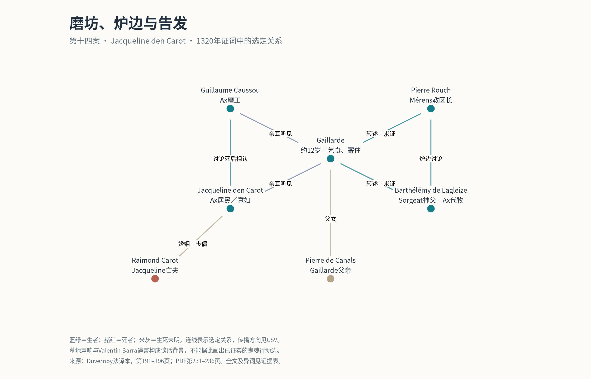
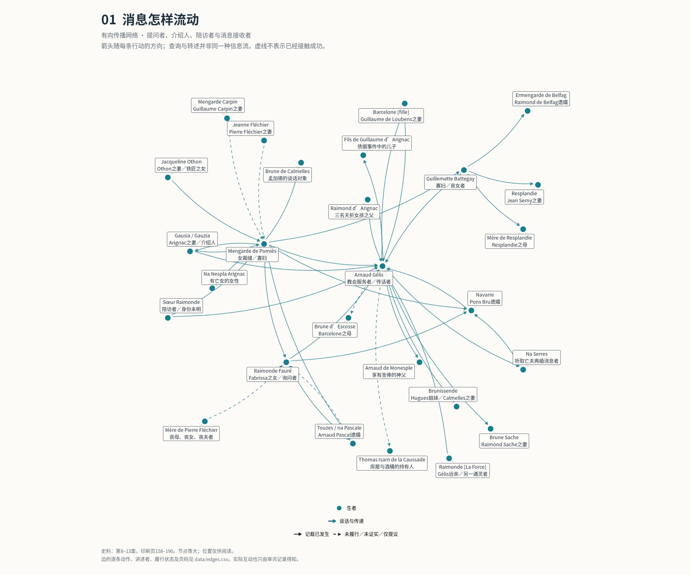

# Medieval Ghost

围绕 Arnaud Gélis 的中世纪生死关系与社会网络研究。

## 扩展02：第三案补齐，第14–16案全文阅读

本批逐页读完99页正文及注释，另读4张插图图题。新增65个人物节点、82条关系断言、42条定位摘录；当前合并版为266节点、379条关系断言。全文阅读与穷尽编码分别记录，不以关键词命中代替通读。

- [详细阅读报告、发现及限制](gelis_network_reconstruction/research/expansion_02/README.md)
- [逐页阅读记录](gelis_network_reconstruction/research/expansion_02/reading_log.csv) · [法文摘录与来源](gelis_network_reconstruction/research/expansion_02/evidence.csv)
- [新增关系](gelis_network_reconstruction/research/expansion_02/assertions.csv) · [撤回及未证实指控](gelis_network_reconstruction/research/expansion_02/excluded_claims.csv)
- [最新合并数据及GraphML](gelis_network_reconstruction/analysis/expanded)
- [第十四案关系图与R脚本](gelis_network_reconstruction/research/expansion_02/render_case14.R)

下一案：第17案 Baruch。原五张核心图继续保留为v1快照。下列扩展01数字是该批完成时的历史记录。

## 扩展01：从第一案开始

已加入第1—7案的选择性关系编码（第3案为重点段落核读，未完成全文精读）：新增83节点、130条关系陈述、64条带原文摘录的证据。合并版201节点、297条关系；不等于201名已确认不同的历史人物。

- [本批发现、方法和覆盖范围](gelis_network_reconstruction/research/expansion_01/README.md)
- [详细证据与页码](gelis_network_reconstruction/research/expansion_01/evidence.csv)
- [每案阅读进度](gelis_network_reconstruction/research/expansion_01/case_review.csv)
- [合并版人物与关系数据](gelis_network_reconstruction/analysis/expanded)
- [同名身份判断](gelis_network_reconstruction/research/expansion_01/identity_decisions.csv)

运行 `Rscript build_expanded.R` 可重建扩展数据。全卷176条姓名检索命中另存为待核查队列，不能视为已确认的关系。

## Gélis 社会网络（R）：核心v1快照

- [项目说明与运行方法](gelis_network_reconstruction/README_zh.md)
- [五页网络图集](gelis_network_reconstruction/Gelis_Network_Atlas.pdf)
- [人物数据](gelis_network_reconstruction/data/nodes.csv) · [关系数据](gelis_network_reconstruction/data/edges.csv)
- [R 绘图脚本](gelis_network_reconstruction/render_networks.R)

包括 118 个编码节点、167 条关系陈述，以及五组网络可视化。覆盖核心六案及已核读的跨案材料，并非全卷穷尽性网络；身份未决、显灵声称和未履行请求均另行标注。详见项目说明。

