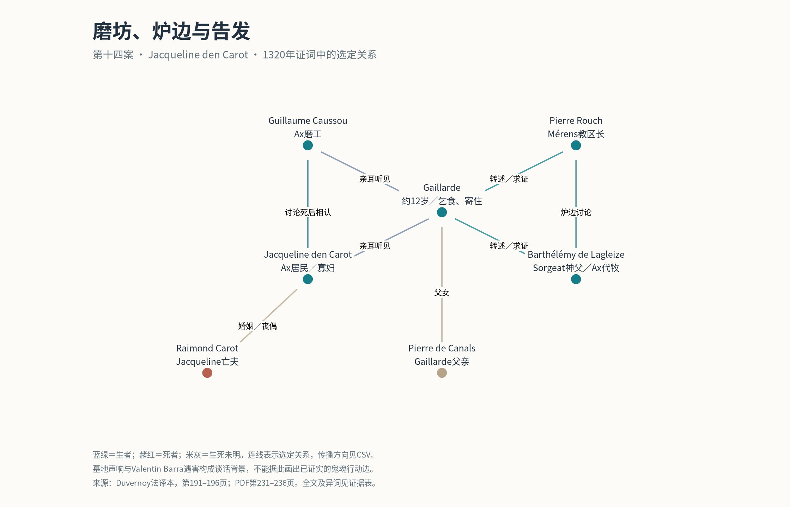

# 第三案补读与第十四至十六案：全文阅读批次02

本批**完整阅读第三案及第十四、十五、十六案的法译本正文、复审和案后注释**，不以姓名搜索代替通读。增加65个人物节点、82条关系断言、42条定位摘录；与前批合并后共266节点、379条关系断言。关系断言不是独立事件数，更不是已经证实的客观交往次数。

|案号|人物|印刷页|PDF物理页（从1起）|阅读结果|
|---|---|---|---|---|
|3|Raymond de Sainte-Foy|55–122|91–162，内含4张插图页|正文及注释逐页补齐；原有11条关系保留，不重复添加|
|14|Jacqueline den Carot|191–198|231–238|全案，包括术法问答、确认口供与注释|
|15|Arnaud de Savinhan|199–218|239–258|全案，包括1322、1323年复审及撤回指控|
|16|Pierre Magre|219–221|259–261|全案，包括1321年确认与注释|

合计99个印刷页，另读4张插图页图题；没有用插图作关系证据。逐页内容记录见 [reading_log.csv](reading_log.csv)。本批不追认此前其他案件为全文读完，也不把扩展01的部分阅读历史改写为当时已经通读。下次顺序起点是**第17案 Baruch**。

## 读法与史料层次

所读为用户上传的 Jean Duvernoy 法译本合并扫描件的 OCR／PDF文本层。页码、摘录字符范围及页面文本哈希可重现；这不是对梵蒂冈拉丁手稿的逐字校勘。OCR可能有分词、字母和数字错误，例如本案文本的 `femme` 被识别成 `Jemme`，不宜直接拿未校字的摘录作为论文定稿引文。

- `reading_log.csv`：逐页阅读覆盖、内容概要、正文／注释层次。这个文件是阅读审计记录，不是靠脚本抓取标题而自动认定“读完”。
- `evidence.csv`：每条摘录的法文文本、案号、说话者、证词日期、事件时间表达、印刷页、PDF页、字符位置、文本及源PDF哈希。脚本只验证所编码摘录的定位，不代替阅读。
- `new_nodes.csv` / `assertions.csv`：新增人物身份与关系；既有ID复用。身份的页级出处与关系的摘录级出处分开保留。
- `thematic_statements.csv`：不适合画成正向关系边的教义、否定行为、条件句、信念转变与匿名社会反应。
- `excluded_claims.csv`：撤回或未证实指控，保留前后证据链接；不能用作事实边。
- `identity_decisions.csv`：同名分离、候选合并和跨案复用理由。
- `node_updates.csv`：有新证据的字段修订；本次补证Raymond父亲在证词时已死。原始批次不覆盖。
- `case_review.csv` / `manifest.json`：阅读范围、数据量与下一起点。

全文读过与人物关系穷尽编码是两项不同的工作。本批提取了主要具名社会交往、亲属、教导、传话及仪式关系，但未穷尽每次出庭的全部公证人和程序见证人，也未把编者注释列举的其他史料人物全部引入主网。不能据现有节点数计算“整个村庄”的人口比例或用未编码当作无关系。

## 第三案：否认代祷不等于情感关系终止

第75页（PDF113）：Raymond明确说不为亡父母祈祷或施舍，并说若相信有用就会如此。他也说没有见过本派同伴死亡或参加其葬礼，不能把他对葬礼做法的猜测当作亲见。对遗赠，他承认的是生前决定所增加的功德，而非缩短炼狱刑罚。

第76页（PDF114）：他又承认圣人知道生者向其致敬、听见祈祷并为生者代祷。这是一般教义，不产生某个地方死者与某个生者之间的具体边。

第103–104页（PDF143–144）：补充匿名招引者在学校探访、住父家、领袖接触与训练路线。原批已记录Jean Lorrain死后仍受爱戴，本批不重复计数。第107页（PDF147）的三本书分别来自Jean、Jacques募捐人、André书商，形成不同于亲属与教义的物质流通线索。

第57页的暂时撤回、第114–115页的部分撤回，与后期核心立场并不完全一致。教义时间线必须保留。领袖继任序列也不自动转化为人与人实际相见：知道某人继任，不等于见过他与前任交往。

## 第十四案：传闻传播与告发造成的关系变化



磨坊中的谈话以Valentin Barra遇害后墓地夜间声响为背景。Caussou、Gaillarde、Jacqueline对谈话的表述不同：Caussou强调似乎疑问；Gaillarde归述为否定复活和死后相认；Jacqueline起初否认，最后承认短暂疑惑但仍否认肯定断言（191–196页）。它们不能合成一份没有矛盾的“原话”。

Gaillarde是Pierre de Canals之女，约12岁，乞讨面粉，住在Mérens教区长Pierre Rouch的Ax住处。她把磨坊话语转述给Rouch和Barthélémy de Lagleize，并向他们求证；她说公开后自己在Ax招人憎恶（192页）。Rouch另行作证支持传播事件，但炉边谈话日期与女孩记忆不同（193页）。两份证词是对同一事件的支持，不应当计为传播两次。匿名居民的敌意不被虚构成一组有名人物的敌对边。

术法部分另有女婿Arnaud Mondon、Arnaud Pellicier之女及施术教士。Bérenger Gasc的名字出自审讯者的问题，Jacqueline答词仅称clerc；这层身份归认在 `evidence_mode` 标明。她说自己带女孩上楼后离开，女婿后来告诉她术法已做；没有找回毛呢的结果，也没有死者显现。

**不能把Valentin直接画为夜间发声的鬼魂**：本案记录声响传闻及人们的讨论，没有建立声响施动者的确定身份；亦没有把他与Gélis所谈Pons Malet合并的依据。Jacqueline den Carot与核心网的Jacqueline Othon也分开。

## 第十五案：邻里监督、财产和供词修订

199–201页的桥头谈话有Cordier、Beubre、Mayshelac、Mercier及Savinhan。只编码实际传话与评价，不因同席建立全连接“朋友网”。202–205页同时保留Frézat和Gaillac的教导、Tolus被归责为教师、后来的自悟与俗谚解释。

206–207页补入邻居Vésian、Montanié、磨坊交谈者Turière和家族关系。Vésian所述房屋买卖时点与编者注19的没收拍卖—回赎解释有张力，交易保留，具体法律过程不被默认为已定。

209–210页出现与Pierre Magre、Guillaume Autast等同批入狱的联系，及Vaissière关于判决动机的评论。Bernard Clergue→Amilhac→Savinhan的消息涉及促Béatrice撤回针对Pierre Clergue的证词。记录“有人报告这项请求”，不写成已成功行贿、已收款或已撤供；50里弗也只是约数，收款对象需跨案核对。

Savinhan先称Gaillac教他承认未曾相信的错误，随后撤回，改称Gaillac要他只承认实际相信的事（209、212–213页）。前说保存在排除表，后说进入修订后的教导边；Spinalbel的劝说则标为有争议的叙事。监禁与司法压力是理解供词的背景，不能因为记录写“自愿”就认定无压力。

## 第十六案：护送亲历与临终入教的转述

Magre亲自与Delaire及被称André者同行；但Amiel临终受入教仪式是Delaire告诉他的，他未目睹，也没听André亲自说（219–220页）。所以同行边和仪式转述边分开。

编者注3将André认作Prades Tavernier，正文后段的 `ce Prades` 也提示联系。目前保留候选同一性记录及两个节点，避免把编者认同误标为证人明确辨认；跨案核定后可做有日志的合并。Magre与第15案囚犯同名且判刑释放时点吻合，复用ID；需要进一步核对第16案所引用的判决文书。

## 与Gélis主问题的关系

本批读到的证词没有找到Gélis与这些新增人物直接交往的明确记述。第15案注13提及Gélis，是编者拿弃绝公式作比较，不是社交联系。本批主要增加比较材料：死后关切的不同形式、传闻如何进入面对面交谈与司法，以及在其他案件可继续追踪的邻里、亲属和狱中人际链。共享主教、共享地名或话题相似不单独当作Gélis网络扩张的证明。

## 复现与分析

在项目根目录运行：

```sh
python research/expansion_02/encode_expansion.py /path/to/register.txt
Rscript build_expanded.R
Rscript research/expansion_02/render_case14.R
```

R合并脚本自动按批次读取扩展表并应用有证据的节点修订。输出在 `analysis/expanded/`。PNG与PDF由R生成；图的全部边及来源ID见 `case14_plotted_edges.csv`。原五张核心图保持v1快照，不冒充扩展全卷图。

主GraphML为有向存储容器，对称关系要读 `directed=false` 属性。计算网络时应先决定是否保留听说、信念评价、有争议叙事及程序层，并合并多证人支持的同一事件；直接把所有断言当独立边会扭曲中心性。
